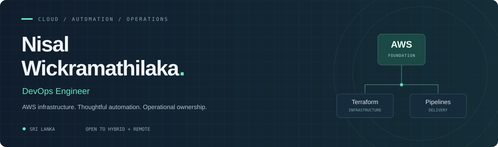

  

  <a href="https://www.linkedin.com/in/nisal-gangana/"><strong>LinkedIn</strong></a>
  &nbsp; / &nbsp;
  <a href="mailto:nisalgangana@gmail.com"><strong>Get in touch</strong></a>
  &nbsp; / &nbsp;
  <a href="https://github.com/nisalgangana?tab=stars"><strong>⭐ Explore my projects</strong></a>

## Building in the cloud. Taking care of what comes next.

I’m **Nisal**, a DevOps Engineer at **Aventure IT**, based in Sri Lanka. As the sole DevOps engineer, I manage **six AWS projects** across infrastructure architecture, delivery automation, cloud costs, security and service availability.

Alongside my work, I’m pursuing an **MSc in Artificial Intelligence at SLIIT** and exploring machine learning and neurocomputing through academic projects.

  

### Where I spend my time

| Infrastructure & delivery | Operations & ownership |
| :--- | :--- |
| Designing and managing AWS infrastructure | Maintaining service availability |
| Provisioning resources with Terraform | Managing cloud costs through FinOps |
| Building and maintaining Bitbucket Pipelines | Addressing system security issues |
| Working with Docker deployments | Troubleshooting infrastructure problems |

**AWS services:** ECS · EC2 · RDS · ElastiCache · S3 · ALB · Route 53 · Amplify

**Earlier professional experience:** Kubernetes cluster management · Grafana · Kibana · AWS Security Hub · VMware

## Selected projects

### [Neuroscience & Neurocomputing Portfolio ↗](https://github.com/nisalgangana/neurocomputing-portfolio)
EEG analysis, neural simulations and an MNIST spiking neural network built with Brian2. Developed as part of my MSc coursework.

`Python` `Jupyter` `Brian2` `Neurocomputing`

### [Oral Cancer Prediction ↗](https://github.com/nisalgangana/oral-cancer-prediction-ml)
My Random Forest contribution to an MSc group assignment. Includes preprocessing, feature importance analysis and investigation of data leakage affecting evaluation results.

`Python` `scikit-learn` `Random Forest` `Model Evaluation`

### [CloudDev ↗](https://github.com/nisalgangana/CloudDev)
Practical tutorials covering cloud architecture, AWS, DevOps and web development.

`AWS` `DevOps` `Learning Resources`

## My journey

| Period | Role | Organisation |
| :--- | :--- | :--- |
| Aug 2025 — Present | **DevOps Engineer** | Aventure IT |
| Jan 2024 — Aug 2025 | Associate DevOps Engineer | Aventure IT |
| May 2023 — Jan 2024 | Trainee System Engineer | KBSL IT · Airport assignment |
| Aug 2022 — Apr 2023 | System Support Engineer Intern | Millennium IT ESP |

## Learning, with purpose

- **MSc in Artificial Intelligence — SLIIT:** January 2026 to expected November 2027. Postgraduate Diploma completed.
- **BSc (Hons) in Computer Systems & Network Engineering — SLIIT:** Class of 2023.
- **Preparing for:** AWS Certified Solutions Architect – Associate.
- **Developing further:** Kubernetes knowledge and hands-on practice.

---

  <strong>Open to hybrid and remote DevOps / Cloud Engineering opportunities.</strong> 
  <a href="mailto:nisalgangana@gmail.com">nisalgangana@gmail.com</a>
  &nbsp; · &nbsp;
  <a href="https://www.linkedin.com/in/nisal-gangana/">Let’s connect on LinkedIn ↗</a>

